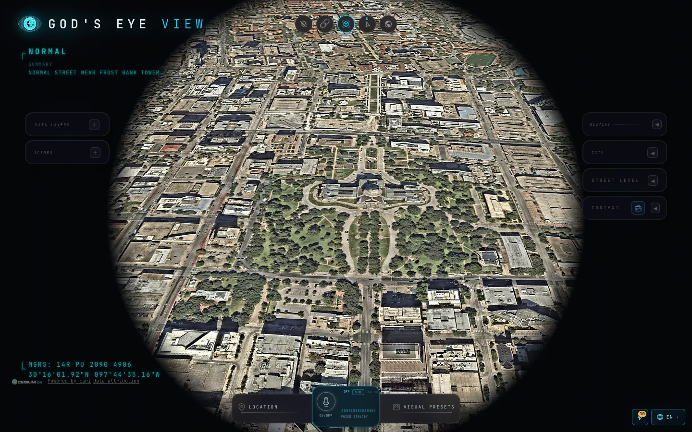

<div align="center">


# MGEV · My God's Eye View

### A 3D globe in your browser that shows the world's public signals, live

[](https://github.com/SeuPut0705/mgev/releases/latest) [](https://github.com/SeuPut0705/mgev/releases) [](LICENSE) [](#-ways-to-run)

**[한국어](README.md)** · **[English](README.en.md)**

<br>

<a href="https://github.com/SeuPut0705/mgev/releases/latest/download/MGEV-mac-arm64.dmg"></a> <a href="https://github.com/SeuPut0705/mgev/releases/latest/download/MGEV-mac-x64.dmg"></a> <a href="https://github.com/SeuPut0705/mgev/releases/latest/download/MGEV-win-x64.exe"></a>

<a href="https://github.com/SeuPut0705/mgev/releases/latest">See all releases →</a>

<sub>The builds are unsigned. The first launch needs one extra step. See [Install the desktop app](#1-desktop-app).</sub>

<br>



</div>

---

## 📖 About

MGEV is a fork of [God's Eye View](https://github.com/bilawalsidhu/gods-eye-view) by Bilawal Sidhu. It puts public signals such as aircraft, ships, satellites, earthquakes, fires, traffic, and public cameras on one 3D globe. You can start from a global view and zoom down to a single aircraft or street, or steer the globe with your voice.

- 🌐 **One globe:** Public data layers share the same 3D space.
- 🔓 **Starts without keys:** Satellite imagery, terrain, aircraft, satellites, earthquakes and more work without API keys.
- 🧩 **Open code:** Each layer is a separate module you can read, change and extend.

> [!IMPORTANT]
> MGEV is an exploratory visualization of public and third-party data. Data may be delayed, incomplete, modeled, inferred or wrong. Do not use it for navigation of aircraft or ships, emergency response, medical or health decisions, investment decisions, or other safety-critical purposes. Verify important information with authoritative sources.

---

## 🎛️ Key features

- **🛩️ Cockpit view:** Ride a tracked aircraft down over the terrain. Sensor styles come along.
- **📡 Contacts:** A 250 km roster around your target. Jump from aircraft to aircraft into their cockpits.
- **🎯 Click to track:** Click a target to lock the camera, draw its trail and show its details.
- **🎨 Sensor styles:** CRT, NVG, FLIR and more, as GLSL screen effects over the globe.
- **📷 Public cameras:** Road CCTV video projected into the 3D city. See [DATA_SOURCES.md](DATA_SOURCES.md) for regions and terms.
- **🛰️ Satellites:** SGP4 orbit propagation with positions and orbit rings.
- **🌦️ Weather:** Forecast wind, observed radar, satellite clouds and tropical cyclone tracks on one timeline. No key needed.
- **🔍 Keyless search:** Decimal coordinates, `geo:` URIs, and bundled cities and landmarks fly you there directly.
- **🎙️ Voice control:** Steer the globe by voice and ask about what you see. Needs an OpenAI or Gemini key.
- **🎬 Scene director:** Record camera tours and import or share scenes.
- **🔗 Share links:** Camera, style, layers and a tracked target fit into one URL.

<div align="center">


</div>

<details>
<summary>More example videos</summary>

| Cockpit view | Airport ground traffic |
|---|---|
|  |  |
| **Camera projected into the city** | **Satellite tracking** |
|  |  |

</details>

<details>
<summary>Layers (selection)</summary>

| Layer | What you get | Source | Key |
|---|---|---|---|
| ✈️ Live aircraft | Live aircraft and route history | OpenSky, adsb.lol | 🟢 (optional 🟡) |
| 🎖️ Military aircraft | ADS-B military traffic, emergency squawks | adsb.lol | 🟢 |
| 🚢 Ships | Ships worldwide | AISStream | 🟡 |
| 🛰️ Satellites | 838-object catalog, colour-coded by class | CelesTrak | 🟢 |
| 🌍 Earthquakes | Seismic activity, last 24 hours | USGS | 🟢 |
| 🔥 Fires | Fire detections, last 24 hours | NASA FIRMS | 🟡 |
| 🚗 Traffic | Simulated vehicles on OSM roads (live speeds with TomTom) | OSM (+ TomTom optional) | 🟢 |
| 📹 CCTV | Public cameras across several regions | Regional traffic agencies | 🟢 (some 🟡) |
| 📻 Radio | Geolocated world radio stations | Radio Browser and broadcasters | 🟢 |
| 🚀 Launches | Last 30 days of launches with replays | Launch Library 2 | 🟢 |
| 🌬️ Wind / ☁️ Weather | Forecast wind, radar, clouds, cyclones | NOAA, ECMWF | 🟢 |

🟢 no key · 🟡 free key · 🔴 metered key. For the full list and sources, see [docs/CURRENT-STATE.md](docs/CURRENT-STATE.md) and [DATA_SOURCES.md](DATA_SOURCES.md).

</details>

---

## 🚀 Ways to run

Pick whichever fits you.

| Option | Best for | Needs Node.js |
|---|---|---|
| **1. Desktop app** | Install and go | No |
| **2. Double-click launcher** | Run from a downloaded copy of the repo | Yes (Node.js 24 LTS) |
| **3. Terminal or Docker** | Development, or running in a container | Terminal: yes · Docker: no |

### 1. Desktop app

Use the **Download** buttons at the top. The file names stay the same for every release.

| System | File |
|---|---|
| macOS, Apple Silicon | `MGEV-mac-arm64.dmg` |
| macOS, Intel | `MGEV-mac-x64.dmg` |
| Windows, x64 | `MGEV-win-x64.exe` |

<details>
<summary>First-launch steps (unsigned builds)</summary>

The builds are not signed, so your OS may block the first launch.

**macOS**
1. Open the `.dmg` and drag **MGEV** into **Applications**.
2. Right-click the app and choose **Open**.
3. If macOS still says the app is damaged, run this once in Terminal, then open the app again:

   ```bash
   xattr -cr "/Applications/MGEV.app"
   ```

**Windows**
1. If SmartScreen warns about an unknown publisher, choose **More info → Run anyway**.

</details>

App data (keys saved in Provider Settings, caches and logs) lives in your user data folder:

- macOS: `~/Library/Application Support/MGEV`
- Windows: `%APPDATA%\MGEV`

To build the app yourself, see [desktop/README.md](desktop/README.md).

### 2. Double-click launcher (from the repo)

1. Install [Node.js 24 LTS](https://nodejs.org/) (once).
2. Get the repo with `git clone`, or **Code → Download ZIP** and unzip it.
3. Double-click the launcher for your system:

| System | Launcher |
|---|---|
| macOS | `Start-Mac.command` |
| Windows | `Start-Windows.bat` |

The first run installs dependencies, which takes a few minutes. Later runs start in seconds. Your browser opens `http://localhost:4173` (or the next free port). Keep the launcher window open while you use the app; close it to stop.

<details>
<summary>If the launcher is blocked</summary>

- **macOS:** Right-click and choose **Open**. If it says the file is not executable, run `chmod +x Start-Mac.command` once.
- **Windows:** If SmartScreen warns, choose **More info → Run anyway**.

</details>

### 3. Terminal or Docker

**Terminal** (Node.js 24.14.0 or later, or 26.x):

```bash
git clone https://github.com/SeuPut0705/mgev.git
cd mgev
npm ci
npm run doctor
npm run dev
```

Open `http://localhost:4173`. `npm run doctor` checks your Node version and the primary provider routes.

<details>
<summary>macOS shortcut and cache reset</summary>

`./scripts/dev-fresh.sh` clears the Vite cache and, if keys are configured, reads them from the macOS Keychain. It also starts without keys.

</details>

**Docker** (no Node.js install needed):

```bash
git clone https://github.com/SeuPut0705/mgev.git
cd mgev
docker compose up
```

Open `http://localhost:4173`. Everything the app saves (`.env`, `.gev-cache/`, `.gev-logs/`) stays in the cloned folder. The port is published to `127.0.0.1` only. See [compose.yaml](compose.yaml).

<details>
<summary>Docker advanced setup: Linux, NAS, reverse proxy, IPv6</summary>

**Linux / NAS:** Run as the user who should own the files.

```bash
env UID=$(id -u) GID=$(id -g) docker compose up
```

Keep the `env`: bash treats `UID` as read-only, so a plain `UID=…` prefix is ignored. Docker Desktop on macOS and Windows maps ownership for you.

**Reverse proxy:** Provider Settings refuses proxied requests on purpose. Put keys in `.env` or environment variables, and add your hostname to `GEV_ALLOWED_HOSTS`, for example `GEV_ALLOWED_HOSTS=globe.example.lan`.

**Publishing the port beyond your machine:** Provider Settings can be reached by others. Use `GEV_KEY_SETUP_TRUSTED_PEERS=none docker compose up` to trust no gateway, and put keys in `.env` by hand. See [SECURITY.md](SECURITY.md).

**IPv6-only networks:** The launcher reads the IPv4 default gateway, so Provider Settings refuses saves. Put keys in `.env` by hand.

**Tests:** Inside the container, `npm run build` and `npm test` work. Run `npm run test:track` on the host.

</details>

---

## 🔑 API keys (optional)

Keys are **not required.** Click **POWER UP** in the app and open **Provider Settings** to add one. Most layers work without any key.

| Key | What it enables | Cost |
|---|---|---|
| 🟡 **Cesium ion** | Google Photorealistic 3D cities, world terrain | Free Community plan for eligible personal, non-commercial use (quotas apply) |
| 🔴 **Google Maps** | Direct Google 3D, Google place search, Street View | Billing-enabled, metered |
| 🔴 **OpenAI** | Voice control, AI HUD summary | Metered API usage (the app shows a $2 warning and a $5 hard cap) |
| 🟡 **AISStream** | Live ships | Free signup |
| 🟡 **NASA FIRMS** | Live fires | Free |
| 🟡 **TomTom** | Live flow speeds for simulated traffic | Free tier |
| 🟡 **Mapillary** | Street Level photos | Free client token |
| 🟡 **OpenSky** | Higher aircraft polling allowance | Free (anonymous access also works) |

> [!NOTE]
> Provider terms, quotas, pricing and eligibility change over time. Check each provider's current policy before you sign up. Cesium ion's free plan is limited to eligible personal, non-commercial use, and direct Google access requires billing and budget alerts. Restrict browser-side keys (Google Maps, Cesium ion) to your domains in the provider console.

For costs and the full list of sources, see [DATA_SOURCES.md](DATA_SOURCES.md) and [SECURITY.md](SECURITY.md).

<details>
<summary>Environment variables (headless, scripted)</summary>

Put keys in the repo-root `.env` (see `.env.example`) or pass them as environment variables:

```bash
OPENAI_API_KEY="…" AISSTREAM_API_KEY="…" npm run dev -- --host localhost --port 4173
```

On macOS you can store keys in the Keychain, and `./scripts/dev-fresh.sh` will read them.

</details>

---

## 🌐 Languages

- App interface: **English** and **한국어 (Korean)**
- Translation and string management: [docs/I18N.md](docs/I18N.md), [docs/TRANSLATORS.md](docs/TRANSLATORS.md)
- Korean user guide: [docs/translations/ko.md](docs/translations/ko.md)

---

## 💾 Where your data lives

| How you run it | Location |
|---|---|
| Desktop app | macOS: `~/Library/Application Support/MGEV` · Windows: `%APPDATA%\MGEV` |
| From the repo (terminal, launcher) | `.env`, `.gev-cache/`, `.gev-logs/` in the repo folder |
| Docker | The cloned repo folder (same files) |

`.env` is excluded from Git. Before a secret is written, the file is made readable only by its owner. Keys stay in local files and are used only to contact providers.

---

## 🛠️ Development

- Development happens on the **`dev`** branch.
- Pushing to **`main`** runs `.github/workflows/release.yml`, which builds the desktop app and publishes a release.
- Contributing and changelog rules: [CONTRIBUTING.md](CONTRIBUTING.md) and [CHANGELOG.md](CHANGELOG.md).
- Architecture and runtime reference: [docs/CURRENT-STATE.md](docs/CURRENT-STATE.md), [docs/APPLICATION.md](docs/APPLICATION.md)
- Performance baseline: [docs/PERFORMANCE.md](docs/PERFORMANCE.md)
- Known issues: [docs/KNOWN-ISSUES.md](docs/KNOWN-ISSUES.md)
- Use MGEV from Claude Desktop or Codex through its MCP server: [docs/MCP_SETUP.md](docs/MCP_SETUP.md)

Report security issues through [SECURITY.md](SECURITY.md), not public issues.

---

## 🙏 Credits and license

- MGEV is built on **[God's Eye View](https://github.com/bilawalsidhu/gods-eye-view)** by Bilawal Sidhu and Sameh Khamis (Halfpixel). Thank you to the original project.
- License: **[MIT](LICENSE)**. The original copyright notice and MIT terms are kept.
- Third-party notices: [THIRD_PARTY_NOTICES.md](THIRD_PARTY_NOTICES.md)
- Data sources and terms: [DATA_SOURCES.md](DATA_SOURCES.md)

<sub>Map tiles, 3D tiles and camera feeds are subject to each provider's terms and attribution requirements. See the data sources document.</sub>
