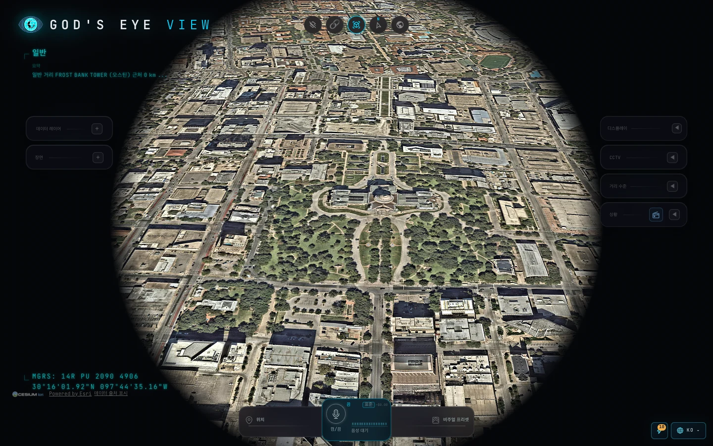
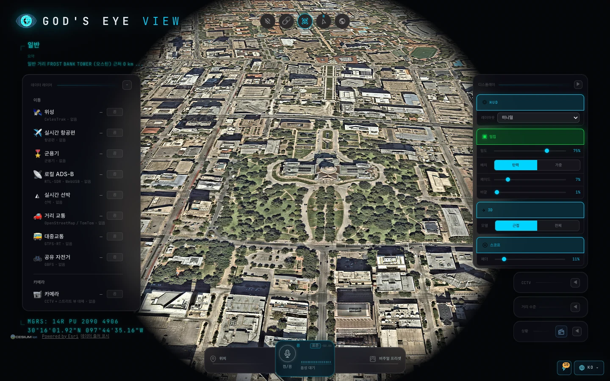

<div align="center">


# MGEV · My God's Eye View

### 브라우저 속 3D 지구본에서 공개 데이터로 세상을 실시간으로 보는 도구

[](https://github.com/SeuPut0705/mgev/releases/latest) [](https://github.com/SeuPut0705/mgev/releases) [](LICENSE) [](#-실행-방법)

**[한국어](README.md)** · **[English](README.en.md)**

<br>

<a href="https://github.com/SeuPut0705/mgev/releases/latest/download/MGEV-mac-arm64.dmg"></a> <a href="https://github.com/SeuPut0705/mgev/releases/latest/download/MGEV-win-x64.exe"></a>

<a href="https://github.com/SeuPut0705/mgev/releases/latest">모든 릴리스 보기 →</a>

<sub>빌드는 서명되지 않았습니다. 처음 실행할 때 한 번만 추가 단계가 필요합니다. 아래 [설치 안내](#1-데스크톱-앱)를 확인하세요.</sub>

<br>



</div>

---

## 📖 소개

MGEV는 [God's Eye View](https://github.com/bilawalsidhu/gods-eye-view)(Bilawal Sidhu)를 기반으로 한 포크입니다. 3D 지구본 위에 항공기, 선박, 위성, 지진, 화재, 교통, 공개 카메라 같은 공개 신호를 한데 모읍니다. 전역 시야에서 시작해 개별 항공기나 거리까지 내려갈 수 있고, 음성으로 지구본을 조작할 수도 있습니다.

- 🌐 **하나의 지구본:** 여러 공개 데이터 레이어를 같은 3D 공간에 겹쳐 보여줍니다.
- 🔓 **키 없이 시작:** 위성 영상과 지형, 항공기, 위성, 지진 등 많은 레이어는 API 키 없이 동작합니다.
- 🧩 **열린 코드:** 각 레이어는 별도 모듈이므로 직접 읽고 수정하고 확장할 수 있습니다.

> [!IMPORTANT]
> MGEV는 공개 데이터와 제3자 데이터를 탐색하기 위한 시각화 도구입니다. 데이터는 지연되거나, 불완전하거나, 추정치이거나, 틀릴 수 있습니다. 항해, 비행, 응급 대응, 의료, 투자 등 안전이나 운영이 걸린 판단에 사용하지 마세요. 중요한 정보는 공식 기관의 자료로 확인하세요.

---

## 🎛️ 주요 기능

- **🛩️ 조종석 시점:** 추적 중인 항공기에 탑승해 지형 위를 따라 내려갑니다. 센서 스타일도 함께 바뀝니다.
- **📡 접촉 목록:** 대상 주변 250 km 안의 항공기 목록을 보고 조종석으로 바로 이동합니다.
- **🎯 클릭 추적:** 대상을 클릭하면 카메라가 고정되고 궤적과 상세 정보가 표시됩니다.
- **🎨 센서 스타일:** CRT, NVG, FLIR 등 셰이더 기반 화면 효과로 지구본을 다시 렌더링합니다.
- **📷 공개 카메라:** 도로 CCTV 영상을 3D 도시 위에 투영합니다. 지역별 카메라 목록은 [DATA_SOURCES.md](DATA_SOURCES.md)를 참고하세요.
- **🛰️ 위성:** SGP4로 궤도를 계산해 위성의 위치와 궤도선을 표시합니다.
- **🌦️ 기상:** 예보 바람장, 관측 레이더, 위성 구름, 열대저기압 경로를 하나의 타임라인에서 봅니다. 키가 필요 없습니다.
- **🔍 키 없는 검색:** 십진 좌표, `geo:` URI, 번들된 도시와 랜드마크로 바로 이동합니다.
- **🎙️ 음성 제어:** 마이크로 지구본을 조작하고, 항공기와 위성 등에 대해 질문할 수 있습니다. OpenAI 또는 Gemini 키가 필요합니다.
- **🎬 장면 연출:** 카메라 투어를 녹화하고, 장면 파일을 가져오거나 공유합니다.
- **🔗 공유 링크:** 카메라 위치, 스타일, 레이어, 추적 대상을 URL 하나에 담습니다.

<div align="center">



</div>

<details>
<summary>예시 영상 더 보기</summary>

| 조종석 시점 | 공항 지상 교통 |
|---|---|
|  |  |
| **도로 CCTV 투영** | **위성 추적** |
|  |  |

</details>

<details>
<summary>레이어 목록 (일부)</summary>

| 레이어 | 제공 내용 | 출처 | 키 |
|---|---|---|---|
| ✈️ 실시간 항공기 | 실시간 항공기와 항적 기록 | OpenSky, adsb.lol | 🟢 (선택 🟡) |
| 🎖️ 군용 항공기 | ADS-B 군용 트래픽, 긴급 신호 | adsb.lol | 🟢 |
| 🚢 선박 | 전 세계 선박 | AISStream | 🟡 |
| 🛰️ 위성 | 838개 카탈로그, 계층별 색상 | CelesTrak | 🟢 |
| 🌍 지진 | 최근 24시간 지진 활동 | USGS | 🟢 |
| 🔥 화재 | 최근 24시간 화재 탐지 | NASA FIRMS | 🟡 |
| 🚗 교통 | OSM 도로 위 시뮬레이션 차량 | OSM (+ TomTom 선택) | 🟢 |
| 📹 CCTV | 여러 지역의 공개 카메라 | 지역 교통 기관 | 🟢 (일부 🟡) |
| 📻 라디오 | 지리 정보가 있는 세계 라디오 방송 | Radio Browser 등 | 🟢 |
| 🚀 우주 발사 | 최근 30일 발사와 재현 영상 | Launch Library 2 | 🟢 |
| 🌬️ 바람 / ☁️ 기상 | 예보 바람, 레이더, 구름, 열대저기압 | NOAA, ECMWF | 🟢 |

🟢 키 없음 · 🟡 무료 키 · 🔴 종량제 키. 전체 목록과 출처는 [docs/CURRENT-STATE.md](docs/CURRENT-STATE.md)와 [DATA_SOURCES.md](DATA_SOURCES.md)를 참고하세요.

</details>

---

## 🚀 실행 방법

세 가지 방법 중 편한 것을 고르세요.

| 방법 | 누구에게 맞나요 | Node.js 필요 |
|---|---|---|
| **1. 데스크톱 앱** | 설치 파일로 바로 쓰고 싶은 분 | 아니요 |
| **2. 더블클릭 실행기** | 저장소를 내려받아 간단히 실행하고 싶은 분 | 예 (Node.js 24 LTS) |
| **3. 터미널 / Docker** | 개발하거나 컨테이너로 돌리고 싶은 분 | 터미널: 예 / Docker: 아니요 |

### 1. 데스크톱 앱

위의 **Download** 버튼으로 설치 파일을 받으세요. 설치 파일 이름은 버전과 무관하게 고정되어 있습니다.

| 시스템 | 파일 |
|---|---|
| macOS, Apple Silicon | `MGEV-mac-arm64.dmg` |
| Windows, x64 | `MGEV-win-x64.exe` |

Intel 맥은 지원하지 않습니다.

<details>
<summary>처음 실행할 때 필요한 단계 (서명되지 않은 빌드)</summary>

빌드가 서명되지 않아 운영체제가 처음 실행을 막을 수 있습니다.

**macOS**
1. `.dmg`를 열고 **MGEV**를 **Applications**(응용 프로그램) 폴더로 끌어 놓습니다.
2. 앱을 **우클릭 → 열기**를 선택합니다.
3. 여전히 "손상되었습니다"라고 나오면 터미널에서 한 번 실행하세요.

   ```bash
   xattr -cr "/Applications/MGEV.app"
   ```

   그다음 앱을 다시 엽니다.

**Windows**
1. SmartScreen 경고가 뜨면 **추가 정보 → 실행**을 선택합니다.

</details>

앱 데이터(Provider Settings에 저장한 키, 캐시, 로그)는 사용자 데이터 폴더에 저장됩니다.

- macOS: `~/Library/Application Support/MGEV`
- Windows: `%APPDATA%\MGEV`

직접 빌드하는 방법은 [desktop/README.md](desktop/README.md)를 참고하세요.

### 2. 더블클릭 실행기 (저장소 실행)

1. [Node.js 24 LTS](https://nodejs.org/)를 설치합니다 (최초 1회).
2. 저장소를 받습니다. `git clone`을 쓰거나 **Code → Download ZIP**으로 내려받아 압축을 풉니다.
3. 운영체제에 맞는 실행기를 더블클릭합니다.

| 시스템 | 실행기 |
|---|---|
| macOS | `Start-Mac.command` |
| Windows | `Start-Windows.bat` |

첫 실행은 의존성을 설치하느라 몇 분 걸립니다. 이후에는 몇 초 만에 시작합니다. 브라우저가 `http://localhost:4173`(또는 비어 있는 다음 포트)을 엽니다. 사용하는 동안 실행기 창을 열어 두고, 닫으면 종료됩니다.

<details>
<summary>실행기가 막힐 때</summary>

- **macOS:** 우클릭 후 **열기**를 선택합니다. "실행 파일이 아니다"라고 나오면 `chmod +x Start-Mac.command`를 한 번 실행하세요.
- **Windows:** SmartScreen 경고가 뜨면 **추가 정보 → 실행**을 선택합니다.

</details>

### 3. 터미널 또는 Docker

**터미널** (Node.js 24.14.0 이상 또는 26.x):

```bash
git clone https://github.com/SeuPut0705/mgev.git
cd mgev
npm ci
npm run doctor
npm run dev
```

브라우저에서 `http://localhost:4173`를 엽니다. `npm run doctor`는 Node 버전과 기본 제공자 경로를 점검합니다.

<details>
<summary>macOS 단축 명령과 캐시 초기화</summary>

`./scripts/dev-fresh.sh`는 Vite 캐시를 지우고, 설정된 경우 macOS 키체인에서 키를 읽어 실행합니다. 키 없이도 실행됩니다.

</details>

**Docker** (Node 설치 불필요):

```bash
git clone https://github.com/SeuPut0705/mgev.git
cd mgev
docker compose up
```

`http://localhost:4173`를 엽니다. 앱이 저장하는 모든 데이터(`.env`, `.gev-cache/`, `.gev-logs/`)는 복제한 폴더 안에 남습니다. 포트는 기본적으로 `127.0.0.1`에만 열립니다. 설정 파일은 [compose.yaml](compose.yaml)을 참고하세요.

<details>
<summary>Docker 고급 설정: Linux, NAS, 리버스 프록시, IPv6</summary>

**Linux / NAS:** 파일을 쓸 사용자의 ID로 실행하세요.

```bash
env UID=$(id -u) GID=$(id -g) docker compose up
```

`UID`는 bash에서 읽기 전용이므로 `env`를 빼면 무시됩니다. Docker Desktop(macOS, Windows)은 소유권을 자동으로 맞춥니다.

**리버스 프록시:** Provider Settings는 프록시를 거친 요청을 의도적으로 거부합니다. 키는 `.env`나 환경 변수로 넣고, 접속할 호스트 이름을 `GEV_ALLOWED_HOSTS`에 추가하세요. 예: `GEV_ALLOWED_HOSTS=globe.example.lan`.

**포트를 외부에 여는 경우:** Provider Settings가 함께 공개될 수 있습니다. `GEV_KEY_SETUP_TRUSTED_PEERS=none docker compose up`처럼 신뢰 게이트웨이를 끄고, 키는 `.env`에 직접 넣으세요. 자세한 내용은 [SECURITY.md](SECURITY.md)를 참고하세요.

**IPv6 전용 네트워크:** 실행기가 IPv4 기본 게이트웨이를 읽기 때문에 Provider Settings가 저장을 거부합니다. 키를 `.env`에 직접 넣으세요.

**테스트:** 컨테이너 안에서는 `npm run build`와 `npm test`만 실행됩니다. `npm run test:track`은 호스트에서 실행하세요.

</details>

---

## 🔑 API 키 (선택)

키는 **필수가 아닙니다.** 앱에서 **POWER UP** 버튼을 눌러 **Provider Settings**에 입력하면 해당 기능이 켜집니다. 키를 입력하지 않아도 대부분의 레이어는 동작합니다.

| 키 | 무엇이 켜지나요 | 비용 |
|---|---|---|
| 🟡 **Cesium ion** | Google Photorealistic 3D 도시, 세계 지형 | 개인 비상업 용도 무료 플랜 (조건과 할당량 있음) |
| 🔴 **Google Maps** | Google 3D 직접 연결, Google 장소 검색, Street View | 결제 활성화 필요, 사용량 과금 |
| 🔴 **OpenAI** | 음성 제어, AI HUD 요약 | API 사용량 과금 (앱에서 $2 경고, $5 한도) |
| 🟡 **AISStream** | 실시간 선박 | 무료 가입 |
| 🟡 **NASA FIRMS** | 실시간 화재 | 무료 |
| 🟡 **TomTom** | 시뮬레이션 교통의 실시간 속도 | 무료 티어 |
| 🟡 **Mapillary** | Street Level 사진 | 무료 클라이언트 토큰 |
| 🟡 **OpenSky** | 항공기 조회 한도 증가 | 무료 (익명 접속도 가능) |

> [!NOTE]
> 제공자의 약관, 할당량, 요금, 자격 조건은 수시로 바뀝니다. 키를 발급받기 전에 각 제공자의 최신 정책을 확인하세요. 특히 Cesium ion 무료 플랜은 개인 비상업 용도에 한정되고, Google 직접 연결은 결제 계정과 예산 알림 설정이 필요합니다. 브라우저에서 쓰는 키(Google Maps, Cesium ion)는 제공자 콘솔에서 도메인 제한을 거세요.

자세한 비용과 키 목록은 [DATA_SOURCES.md](DATA_SOURCES.md)와 [SECURITY.md](SECURITY.md)를 참고하세요.

<details>
<summary>환경 변수로 설정하기 (헤드리스, 자동화)</summary>

`.env.example`을 참고해 저장소 루트의 `.env`에 넣거나 환경 변수로 전달합니다.

```bash
OPENAI_API_KEY="…" AISSTREAM_API_KEY="…" npm run dev -- --host localhost --port 4173
```

macOS에서는 키체인에 저장한 뒤 `./scripts/dev-fresh.sh`가 자동으로 읽도록 할 수도 있습니다.

</details>

---

## 🌐 언어

- 앱 화면: **한국어**, **English**
- 번역 기여와 문자열 관리: [docs/I18N.md](docs/I18N.md), [docs/TRANSLATORS.md](docs/TRANSLATORS.md)
- 한국어 사용 안내: [docs/translations/ko.md](docs/translations/ko.md)

---

## 💾 데이터 저장 위치

| 실행 방식 | 저장 위치 |
|---|---|
| 데스크톱 앱 | macOS: `~/Library/Application Support/MGEV` · Windows: `%APPDATA%\MGEV` |
| 저장소 실행 (터미널, 실행기) | 저장소 폴더의 `.env`, `.gev-cache/`, `.gev-logs/` |
| Docker | 복제한 저장소 폴더 (위와 동일) |

`.env`는 Git에서 제외되며, 키를 쓰기 전에 소유자만 읽을 수 있도록 권한을 제한합니다. 키는 로컬 파일에만 저장되고 제공자와 통신할 때만 사용됩니다.

---

## 🛠️ 개발

- 개발은 **`dev`** 브랜치에서 합니다.
- **`main`** 브랜치에 push하면 GitHub Actions(`.github/workflows/release.yml`)가 데스크톱 앱을 빌드해 릴리스를 만듭니다.
- 기여 방법과 변경 기록 규칙은 [CONTRIBUTING.md](CONTRIBUTING.md)와 [CHANGELOG.md](CHANGELOG.md)를 참고하세요.
- 구조와 런타임 참고 자료: [docs/CURRENT-STATE.md](docs/CURRENT-STATE.md), [docs/APPLICATION.md](docs/APPLICATION.md)
- 성능 기준값: [docs/PERFORMANCE.md](docs/PERFORMANCE.md)
- 알려진 문제: [docs/KNOWN-ISSUES.md](docs/KNOWN-ISSUES.md)
- MCP 서버로 Claude Desktop, Codex 등에서 지구본 열기: [docs/MCP_SETUP.md](docs/MCP_SETUP.md)

보안 문제는 공개 이슈 대신 [SECURITY.md](SECURITY.md)의 절차를 따라 주세요.

---

## 🙏 크레딧과 라이선스

- MGEV는 **[God's Eye View](https://github.com/bilawalsidhu/gods-eye-view)** (Bilawal Sidhu, Sameh Khamis / Halfpixel)를 기반으로 합니다. 원본 프로젝트에 감사드립니다.
- 라이선스: **[MIT](LICENSE)**. 원본 저작권 고지와 MIT 조건을 그대로 유지합니다.
- 제3자 구성 요소 고지: [THIRD_PARTY_NOTICES.md](THIRD_PARTY_NOTICES.md)
- 데이터 출처와 이용 조건: [DATA_SOURCES.md](DATA_SOURCES.md)

<sub>지도 타일, 3D 타일, 카메라 영상 등은 각 제공자의 약관과 표시 의무가 적용됩니다. 데이터 출처 문서를 확인하세요.</sub>
